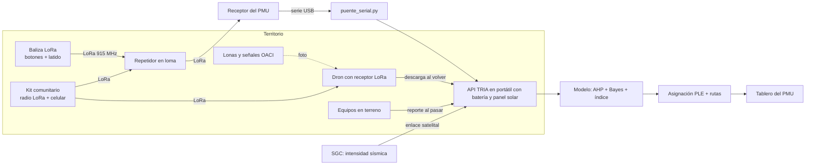

# Arquitectura de TRIA

## Flujo de decisión (cada 15 minutos o ante un evento)

1. **Actualizar evidencia:** reportes, latidos, vías caídas, intensidad sísmica y ocupación hospitalaria.
2. **Estimar** la probabilidad de afectación grave de cada zona en silencio (Bayes).
3. **Calcular** el índice de urgencia con los pesos AHP definidos por el Consejo Municipal de Gestión del Riesgo.
4. **Asignar** equipos a necesidades con programación lineal entera: un equipo por necesidad y una necesidad por equipo, sin duplicar.
5. **Enrutar** por el grafo vial sin las vías caídas y elegir el hospital con cupo y energía.
6. **Explicar:** cada recomendación muestra el aporte de cada criterio. El PMU acepta o ajusta.
